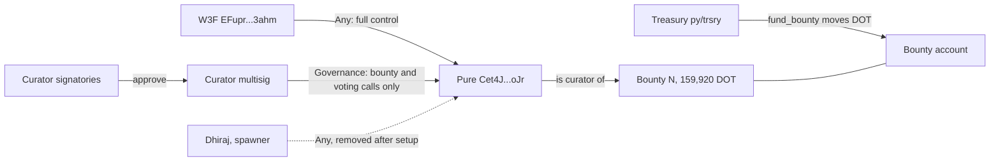
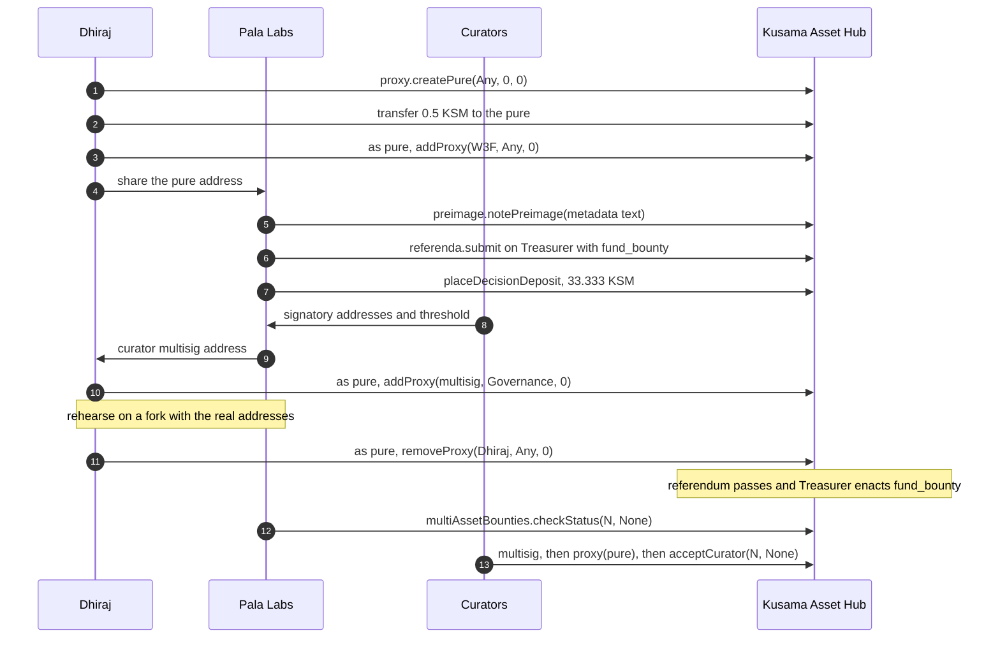
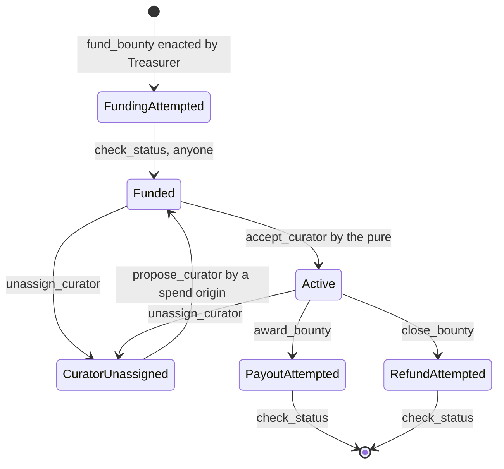

# Cypherpunk Vision Fund: Multi-Asset Bounty Setup on Kusama Asset Hub

Nov 10, 2026 · @Dhiraj

**TL;DR.** The Cypherpunk Vision Fund is a 159,920 DOT multi-asset bounty on Kusama Asset Hub. Its curator is a pure proxy that W3F controls fully (Any), with the curator team acting through a Governance proxy. This is the same setup as live bounties #1 and #2. The pure exists, is funded, and has W3F as Any. Three details of the original request had to change. The amount is **1,599,200,000,000,000** planck, not 599,200,000,000,000. The proposal must use the **Treasurer** track, because Big Spender is too small. The metadata must be a noted preimage, so it cannot be "-". The whole flow ran on a fork of live Kusama Asset Hub, first with stand-in accounts and then with the real pure, and every check passed.

## At a glance

| Item | Value |
| --- | --- |
| Chain | Kusama Asset Hub (`statemine` spec 2005001, fellows runtimes v2.5.3) |
| Bounty | Cypherpunk Vision Fund, paid in DOT |
| Value | 159,920 DOT = `1599200000000000` planck (DOT has 10 decimals here) |
| Track | Treasurer (track 11). The value counts as 39,980 KSM, and Big Spender stops at 33,333 KSM. |
| Curator (pure proxy) | `Cet4JMngBdyWr7Ug6bwp6PG4xZG4EMjSXXnjZC8jJjd8oJr` |
| W3F (Any on the pure) | `EFuprYL5sShF5qao4F9hVRrkbutFeoAgn4HHehq4Rkx3ahm` |
| Curator multisig (Governance on the pure) | Pending, waiting for the curators' addresses |
| Metadata | `CYPHERPUNK VISION FUND`, blake2-256 `0x9296ffa8bd941498757b92ea45776279f9d32773fc183aacb132494703c884bc` |
| `fund_bounty` call (82 bytes) | `0x6200050000020109020f00c0ecc376ae0500037a854f0918e502caa7c021a442b29bbb3d9dab4441b0b21081e7619f6c9fea9296ffa8bd941498757b92ea45776279f9d32773fc183aacb132494703c884bc` |
| `fund_bounty` preimage hash | `0xc780539c4c52d41e7b46f986abed51b982d039bef05913199cf25e2ef205856d`, length 82 |
| Submission call | `0x5c005d010149016200050000020109020f00c0ecc376ae0500037a854f0918e502caa7c021a442b29bbb3d9dab4441b0b21081e7619f6c9fea9296ffa8bd941498757b92ea45776279f9d32773fc183aacb132494703c884bc0140380000` |
| Deposits | 0.0333 KSM submission, 33.333 KSM decision (both refundable) |
| Treasurer timing | 2 h prepare, up to 14 days deciding, 48 h confirm, at least 24 h to enactment |
| Treasury DOT today | 159,923.7289650026 DOT. 3.7289650026 DOT is left after funding. |
| Test result | Every check passed on a fork, with stand-in accounts and with the real pure |

The submission call is `referenda.submit(Origins(Treasurer), Inline(fund_bounty), After(14400))`. It assumes the metadata text above. If the text changes, rebuild it with [`scripts/build-calls.cjs`](scripts/build-calls.cjs).

## Status

As of Kusama Asset Hub block 23,638,432:

| Step | Who | Status | Evidence |
| --- | --- | --- | --- |
| D1. Create the pure, `proxy.createPure(Any, 0, 0)` | Dhiraj | Done | [Block 23,637,760, extrinsic 2](https://assethub-kusama.subscan.io/extrinsic/23637760-2) |
| D2. Fund the pure with 0.5 KSM | Dhiraj | Done | Block 23,637,954 |
| D3. Add W3F as Any | Dhiraj | Done | [Block 23,638,219, extrinsic 2](https://assethub-kusama.subscan.io/extrinsic/23638219-2), `ProxyExecuted { result: Ok }` |
| L1. Note the metadata preimage | Pala Labs (proposer) | Pending | |
| L2. Submit on Treasurer and place the decision deposit | Pala Labs | Pending | |
| L3. Create the curator multisig | Pala Labs and curators | Pending | |
| D4. Add the multisig as Governance | Dhiraj | Pending | |
| T1. Rehearse on a fork with the real addresses | Dhiraj and Pala Labs | Pending | |
| D5. Dhiraj removes himself | Dhiraj | Pending | |
| A1, A2. `check_status`, then `accept_curator` | Anyone, then the curators | After enactment | |

The record of the pure's creation, which `killPure` would need, is in [`evidence/pure-record.json`](evidence/pure-record.json).

## Three corrections to the original request

1. **Amount.** 159,920 DOT × 10<sup>10</sup> = 1,599,200,000,000,000 planck. The figure in the request, 599,200,000,000,000, is 59,920 DOT. It also fits under Big Spender, which would hide the mistake.
2. **Track.** `fund_bounty` converts the DOT value to KSM and checks the result against the origin's spend limit. The conversion is native = value × AssetRate(DOT) = 1,599,200,000,000,000 × 25 = 39,980 KSM. Big Spender allows 33,333.33 KSM, so a Big Spender referendum would pass and then fail at enactment with `InsufficientPermission`. Treasurer allows 333,333.33 KSM.
3. **Metadata.** `fund_bounty` requires the hash of a preimage that is already on chain. Bounties #1 and #2 use short titles ("ART & SOCIAL EXPERIMENTS", "ZERO KNOWLEDGE PROOFS"), and the same convention gives `CYPHERPUNK VISION FUND`.

Also note that this bounty uses all of the treasury's DOT except 3.73 DOT. If another DOT spend is paid out first, the funding fails and the proposal has to be resubmitted.

## Who controls the curator

The curator is a pure proxy: an account with no private key that acts only through the proxies attached to it.



On Kusama Asset Hub, the Governance proxy allows Treasury, Bounties, ChildBounties, MultiAssetBounties, ConvictionVoting, Referenda, Whitelist and Utility calls. It does not allow Balances, Proxy or Preimage calls, so the curators cannot move KSM out of the pure or change its proxies. Only W3F can do either.

The two live DOT bounties are set up the same way. Their curators, `HyfBoVzPkikGdDv5P9pNoMkHrQJ5LvktdXwiv9RntbrTHi4` (bounty 1) and `DVYbCSWbNfNxA2DXK1TUJSUaBYZVyeVq6AEvmp98S2nn3LH` (bounty 2), are pure proxies with exactly two proxies each: W3F as Any and one Governance delegate.

## The flow



## Remaining steps

All calls go to Kusama Asset Hub, not the Kusama relay chain. To read any call data back field by field, paste it into Polkadot.js Apps under [Developer → Extrinsics → Decode](https://polkadot.js.org/apps/?rpc=wss%3A%2F%2Fkusama-asset-hub-rpc.polkadot.io#/extrinsics/decode).

**L1. Note the metadata preimage.** Anyone can sign this.

```
preimage.notePreimage(bytes: "CYPHERPUNK VISION FUND")
0x06005843595048455250554e4b20564953494f4e2046554e44
```

**L2. Submit the referendum on the Treasurer track.** Sign the submission call from the table above, then call `referenda.placeDecisionDeposit(<index>)`. The `fund_bounty` call is 82 bytes. Calls up to 128 bytes can be submitted inline, so no second preimage is needed. If your UI asks for a preimage instead, note the call and use hash `0xc780…856d`, length 82. Put the pure address and its intended proxies in the description so voters can check them.

The decoded inner call:

```
multiAssetBounties.fundBounty(
  assetKind: V5 { location: { parents: 0, interior: Here },
                  assetId: { parents: 2, interior: X1(GlobalConsensus(Polkadot)) } },
  value: 1599200000000000,
  curator: Id(Cet4JMngBdyWr7Ug6bwp6PG4xZG4EMjSXXnjZC8jJjd8oJr),
  metadata: 0x9296ffa8bd941498757b92ea45776279f9d32773fc183aacb132494703c884bc)
```

**L3. Create the curator multisig.** The multisig address is derived from the sorted signatories and the threshold, so every curator should derive it and get the same address. It needs no KSM to act as a proxy. Signers pay the fees, and the first approver of each operation puts down about 0.0067 KSM, which is returned when the operation executes.

**D4. Add the multisig as Governance.** Build the call with `node scripts/build-calls.cjs --pure Cet4JMngBdyWr7Ug6bwp6PG4xZG4EMjSXXnjZC8jJjd8oJr --curators <multisig>`.

```
proxy.proxy(real: Cet4J...oJr, forceProxyType: None,
  call: proxy.addProxy(delegate: <multisig>, proxyType: Governance, delay: 0))
```

**T1. Rehearse with the real addresses.** See [Verify it yourself](#verify-it-yourself).

**D5. Dhiraj removes himself.** Only after D4 and T1, and before the referendum reaches its confirmation period.

```
proxy.proxy(real: Cet4J...oJr, forceProxyType: None,
  call: proxy.removeProxy(delegate: JKssqfCAWuENDwzbEQ6mghDGWJq4uJjd7TJjTnmCGbWH8bQ, proxyType: Any, delay: 0))
0x2a0000037a854f0918e502caa7c021a442b29bbb3d9dab4441b0b21081e7619f6c9fea002a0200fe65a6d306be82752f79eb673c076351f44a4026b082b80531af67f08a65044a0000000000
```

Never call `proxy.removeProxies` or `proxy.killPure` through the pure. The first removes every proxy, so nobody can control the curator again. The second deletes the pure.

**After enactment.** Read the bounty index `N` from the `BountyCreated` event. It is 3 if no other bounty is created first.

1. Anyone calls `multiAssetBounties.checkStatus(N, None)`. The DOT moves at enactment, but the bounty stays in `FundingAttempted` until this call, and `accept_curator` fails with `UnexpectedStatus` before it.
2. The curators accept the role with `multisig.asMulti(..., call: proxy.proxy(Cet4J...oJr, None, multiAssetBounties.acceptCurator(N, None)))`. This holds 0.1666666665 KSM on the pure as the curator deposit.



## Decisions

**Treasurer track.** `fund_bounty` requires the KSM value to fit the origin's spend limit ([`multi-asset-bounties/src/lib.rs:597-600`](https://github.com/paritytech/polkadot-sdk/blob/f91ecc274e751e727256ebca4e4a09802bf4880e/substrate/frame/multi-asset-bounties/src/lib.rs#L597-L600)).

| Option | Result |
| --- | --- |
| Big Spender (limit 33,333.33 KSM) | Rejected. The referendum passes, the call fails, and no bounty is created. Tested. |
| Treasurer (limit 333,333.33 KSM) | Chosen. Tested. |
| Root | Rejected. It works, but it is the wrong track for a spend and needs a 3,333 KSM decision deposit. |

The cost is a 33.333 KSM decision deposit instead of 13.333 KSM. Treasurer keeps working unless the DOT rate is raised above 2.08 KSM per DOT.

**Pure proxy as curator, not the multisig.** If the multisig were the curator, changing the team would need `unassign_curator`, a new referendum to propose a curator, and a new `accept_curator`. With a pure, W3F swaps the Governance proxy, and the bounty and curator address stay the same. The trade-off is that W3F's Any proxy has the final say, and the spawner's 0.0067 KSM deposit stays reserved.

**When the spawner leaves.** After the multisig is added and rehearsed, and no later than the start of the referendum's confirmation period. If the curators' addresses arrive late, the spawner leaves anyway and W3F adds the multisig.

## What must hold at enactment

| # | Must hold | Check (Chain state on Kusama Asset Hub) |
| --- | --- | --- |
| I1 | The pure's proxies are exactly W3F Any and the multisig Governance, without the spawner | `proxy.proxies(Cet4J...oJr)` |
| I2 | value = 1,599,200,000,000,000 | Decode the referendum's proposal |
| I3 | Treasury DOT ≥ value | `foreignAssets.account({parents:2, interior:X1(GlobalConsensus(Polkadot))}, F3opxRbN5ZbjJNU511Kj2TLuzFcDq9BGduA9TgiECafpg29)` |
| I4 | The metadata preimage is noted | `preimage.requestStatusFor(0x9296...84bc)` is Some |
| I5 | The pure has free KSM ≥ 0.1667 plus the existential deposit | `system.account(Cet4J...oJr)` |
| I6 | The asset kind matches bounties #1 and #2 | `multiAssetBounties.bounties(1)` |
| I7 | The referendum is on track 11 with origin Treasurer | `referenda.referendumInfoFor(<index>)` |

## What can go wrong

| Mistake | What you see | How to catch it |
| --- | --- | --- |
| Planck typo | A bounty for 59,920 DOT | Decode the call before signing |
| Track below Treasurer | The referendum passes, then `scheduler.Dispatched` shows `Err(InsufficientPermission)` | `build-calls.cjs` prints the lowest track that works |
| Metadata not noted | `Err(PreimageNotExist)` at enactment | I4 |
| Trusting the outer extrinsic's success | ExtrinsicSuccess, but nothing changed | Read the result in `ProxyExecuted`, `MultisigExecuted` or `Dispatched` |
| Another DOT spend paid first | The whole `fund_bounty` call reverts, because Asset Hub pays synchronously (`LocalPay`) | I3 |
| `accept_curator` before `check_status` | `UnexpectedStatus` | Call `check_status` first |
| `removeProxies` or `killPure` run through the pure | The curator is lost, and recovery needs governance | Use only `removeProxy` with a named delegate |
| Curators try to move KSM or change proxies | `system.CallFiltered`, which is intended | Only W3F can do these |

## How it was tested

The first fork run tried Small Spender and failed with `InsufficientPermission`. 159,920 DOT ÷ 25 is about 64 KSM, which looked well under the limit. Reading [`asset-rate/src/lib.rs:246-253`](https://github.com/paritytech/polkadot-sdk/blob/f91ecc274e751e727256ebca4e4a09802bf4880e/substrate/frame/asset-rate/src/lib.rs#L246-L253) showed that the conversion is `rate.saturating_mul_int(balance)`: it multiplies, giving 39,980 KSM. The next run enacted `fund_bounty` as Big Spender, which failed as expected, and as Treasurer, which passed. The treasury's DOT fell by exactly 1,599,200,000,000,000.

Three fork runs, all on Kusama Asset Hub spec 2005001:

| Run | What it shows | Log |
| --- | --- | --- |
| Stand-in setup | Pure created, W3F added as Any, a 2-of-3 multisig added as Governance, spawner removed. The spawner then gets `NotProxy`. | [`evidence/fork-rehearsal-setup.log`](evidence/fork-rehearsal-setup.log) |
| Stand-in funding | Big Spender fails and Treasurer passes. `check_status` succeeds, and `accept_curator` before it fails. The multisig accepts through the proxy, and a KSM transfer through the Governance proxy is filtered. | [`evidence/fork-rehearsal-fund.log`](evidence/fork-rehearsal-fund.log) |
| Real pure | The exact D3 bytes, signed as the real spawner, add W3F. The real W3F address acts as the pure. `fund_bounty` with the real pure as curator is enacted as Treasurer and creates bounty 3. W3F accepts the curator role (0.1667 KSM held), and the spawner removes itself. | [`evidence/fork-dry-run-real-pure.log`](evidence/fork-dry-run-real-pure.log) |

The call encoder in `build-calls.cjs` was checked byte for byte against Polkadot.js for every call in this report.

## Verify it yourself

```bash
cd kusama/cypherpunk-vision-fund-bounty/scripts
npm i

# exact call data for every step
node build-calls.cjs --pure Cet4JMngBdyWr7Ug6bwp6PG4xZG4EMjSXXnjZC8jJjd8oJr --spawner JKssqfCAWuENDwzbEQ6mghDGWJq4uJjd7TJjTnmCGbWH8bQ

# decode a proxy.proxy call and read the pure's live state, creation and funding blocks
node live-check.mjs 0x2a0000037a854f0918e502caa7c021a442b29bbb3d9dab4441b0b21081e7619f6c9fea002a01004a6e4babe3f455d9285bdf3a988e5fbcf53282ba9f2040b15241861b3bf444dc0000000000

# fork of live Kusama Asset Hub on ws://127.0.0.1:8011 (mock signatures, nothing reaches the live chain)
npx @acala-network/chopsticks --config=kah.yml

# in a second terminal: stand-in rehearsal end to end
node cvf-rehearsal.mjs all
# once the multisig is added (T1): check the real pure and let the real signatories accept
PURE=Cet4JMngBdyWr7Ug6bwp6PG4xZG4EMjSXXnjZC8jJjd8oJr SPAWNER=JKssqfCAWuENDwzbEQ6mghDGWJq4uJjd7TJjTnmCGbWH8bQ \
  SIGNATORIES=<a,b,c> THRESHOLD=<t> node cvf-rehearsal.mjs fund
```

In `fund` mode, the script fails if the multisig derived from `SIGNATORIES` and `THRESHOLD` differs from the one on the pure, or if the spawner is still a proxy.

## Costs

| Who | What | KSM | Comes back? |
| --- | --- | --- | --- |
| Dhiraj | Pure creation deposit | 0.006690999969 | Only if the pure is killed |
| Dhiraj | Funding the pure | 0.5 | Stays with the pure, and W3F can withdraw it |
| Pure | Net proxy deposit | 0.000010999989 | When proxies are removed |
| Pure | Curator deposit | 0.1666666665 | On payout or close |
| Pala Labs | Submission and decision deposits | 0.0333 + 33.333 | Yes |
| Pala Labs | Metadata preimage | about 0.0134 | After the bounty ends |
| Curators | Multisig deposit per operation (2-of-3) | about 0.0067 | Yes |

## Glossary

- **Pure proxy**: an account created by `proxy.createPure` with no private key. It acts only through its proxies.
- **Spawner**: the account that created the pure. It starts as the only proxy and holds the creation deposit.
- **Any, Governance**: proxy types. Any allows every call. Governance allows only governance and bounty calls.
- **`proxy.proxy`**: dispatches a call as another account. The outer call succeeds even when the inner call fails.
- **Planck**: the smallest unit. 1 DOT = 10<sup>10</sup> planck, and 1 KSM = 10<sup>12</sup>.
- **Preimage**: bytes stored on chain under their blake2-256 hash.
- **AssetRate**: the on-chain rate that converts a DOT amount to KSM for spend-limit checks. It is 25 per planck, so 1 DOT counts as 0.25 KSM.
- **Relay block number**: governance timing and the proxy pallet on Asset Hub count Kusama relay blocks (6 s each).

## Evidence and sources

- [`substrate/frame/multi-asset-bounties/src/lib.rs:586-628`](https://github.com/paritytech/polkadot-sdk/blob/f91ecc274e751e727256ebca4e4a09802bf4880e/substrate/frame/multi-asset-bounties/src/lib.rs#L586-L628): `fund_bounty`, with the preimage check at :595 and the spend-limit check at :597-600.
- [`substrate/frame/multi-asset-bounties/src/lib.rs:838-866`](https://github.com/paritytech/polkadot-sdk/blob/f91ecc274e751e727256ebca4e4a09802bf4880e/substrate/frame/multi-asset-bounties/src/lib.rs#L838-L866): `accept_curator`, which requires `Funded` and takes the curator deposit.
- [`substrate/frame/asset-rate/src/lib.rs:246-253`](https://github.com/paritytech/polkadot-sdk/blob/f91ecc274e751e727256ebca4e4a09802bf4880e/substrate/frame/asset-rate/src/lib.rs#L246-L253): the conversion is rate × balance.
- [polkadot-fellows/runtimes v2.5.3](https://github.com/polkadot-fellows/runtimes/tree/v2.5.3/system-parachains/asset-hubs/asset-hub-kusama/src): `governance/origins.rs:179-188` sets the spend limits (1 GRAND = 33.33 KSM), `lib.rs:706-716` defines the Governance proxy filter, and `treasury.rs:148-151` and `treasury.rs:188-235` set the curator deposit and the MultiAssetBounties config (`Paymaster = LocalPay`).
- Live chain state on 2026-11-10 at block 23,635,894: treasury DOT `1599237289650026`, AssetRate(DOT) = 25, DOT at 10 decimals and sufficient, and bounties #1 and #2 with their curator pures and metadata.
- [`evidence/pure-record.json`](evidence/pure-record.json): creation, funding and W3F-add records for the pure.
