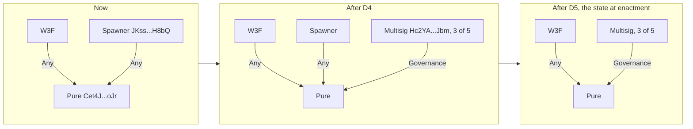
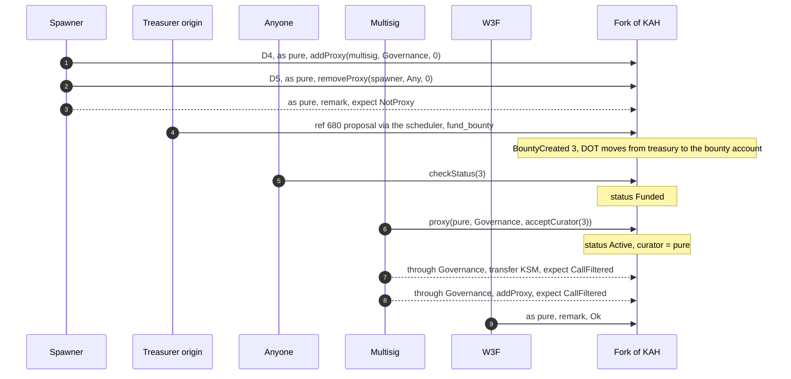

# Cypherpunk Vision Fund: Adding the Curator Multisig as a Governance Proxy

Nov 27, 2026 · @Dhiraj

**TL;DR.** Pala Labs and the curators created a 3-of-5 multisig, `Hc2YA7NqbYDxbuHy5iEwtR6LuehN9TYoNyRzqD3Dc5w3Jbm`. Step D4 adds it to the curator pure `Cet4JMngBdyWr7Ug6bwp6PG4xZG4EMjSXXnjZC8jJjd8oJr` as a Governance proxy. A rehearsal ran on a fork of Kusama Asset Hub as of Nov 27 (spec 2005003). It used the real pure, the real multisig and the exact proposal of [referendum 680](https://kusama.subsquare.io/referenda/680), and all 10 checks passed. D4 and D5 apply. The referendum's proposal creates bounty 3 for 159,920 DOT. The multisig accepts the curator role through its proxy. The Governance proxy cannot move KSM or change proxies. The D4 call is ready for the spawner to sign. In D5 the spawner removes itself, and it must happen before 2026-12-07 01:04 UTC. That is when referendum 680 is expected to start confirming. If approval stays at 50% or more, the bounty is created no earlier than 2026-12-10.

How the pure was created, and why the Treasurer track is needed, is in [README.md](README.md). This report covers what happened after the referendum went live.

## Status

As of Kusama Asset Hub block 24,337,081 (2026-11-27 12:02 UTC):

| Step | Who | Status | Evidence |
| --- | --- | --- | --- |
| L1. Note the metadata preimage | Pala Labs | Done. The text is `Cypherpunk Vision Fund`, hash `0x3b95068048f4db56db684010dfbe7d4a60f557dceeee57f05844657519a17961` | [status log](evidence/status-2026-11-27.log), I4 |
| L2. Submit on Treasurer and place the decision deposit | Pala Labs | Done: [referendum 680](https://kusama.subsquare.io/referenda/680), deciding since relay block 36,210,121 | [status log](evidence/status-2026-11-27.log), I7 |
| L3. Create the curator multisig | Pala Labs and curators | Done: `Hc2YA7…Jbm`, 3-of-5, holds 0.8 KSM | [status log](evidence/status-2026-11-27.log) |
| D4. Add the multisig as Governance | Dhiraj | Call ready and rehearsed. Waiting for the spawner's signature | [D4](#d4-the-call) |
| T1. Rehearse with the real addresses | Dhiraj | Done on a fork. The signatory set is not covered, see [what the test does not cover](#what-the-test-does-not-cover) | [`evidence/fork-t1-real-multisig.log`](evidence/fork-t1-real-multisig.log) |
| D5. The spawner removes itself | Dhiraj | Pending. After the curators confirm the address, and before 2026-12-07 01:04 UTC | [D5](#d5-the-call) |
| A1, A2. `check_status`, then `accept_curator` | Anyone, then the curators | After enactment, no earlier than 2026-12-10 01:04 UTC | [Timeline](#referendum-680-timeline) |

The live referendum differs from the README's suggestions in two places, and both are fine. The metadata text is `Cypherpunk Vision Fund` (hash `0x3b95…7961`), not `CYPHERPUNK VISION FUND`. The proposal is noted as a preimage, hash `0x42b2472aebdbad9e1252b0e0f5ee90c7ac70bdb82b792c57a49923ebad20c8cf`, 82 bytes, with enactment `After(100)`. The track's minimum enactment period of 14,400 blocks (one day) overrides the 100.

## Who controls the curator



Any allows every call. Governance on Kusama Asset Hub allows governance and bounty calls only, so the curators can accept the role, manage child bounties and pay out. They cannot move the pure's KSM or change its proxies. W3F keeps Any, so W3F can replace the multisig later without a referendum.

## D4: the call

The spawner `JKssqfCAWuENDwzbEQ6mghDGWJq4uJjd7TJjTnmCGbWH8bQ` signs this on Kusama Asset Hub, not the relay chain:

```
proxy.proxy(real: Cet4JMngBdyWr7Ug6bwp6PG4xZG4EMjSXXnjZC8jJjd8oJr, forceProxyType: None,
  call: proxy.addProxy(delegate: Hc2YA7NqbYDxbuHy5iEwtR6LuehN9TYoNyRzqD3Dc5w3Jbm, proxyType: Governance, delay: 0))

0x2a0000037a854f0918e502caa7c021a442b29bbb3d9dab4441b0b21081e7619f6c9fea002a0100de7a7fc1794d99892ca3bfac7b5c2a820027196403103262ceed8959618869260700000000
```

To read it back field by field, open [Polkadot.js Apps, Extrinsics, Decode](https://polkadot.js.org/apps/?rpc=wss%3A%2F%2Fkusama-asset-hub-rpc.polkadot.io#/extrinsics/decode/0x2a0000037a854f0918e502caa7c021a442b29bbb3d9dab4441b0b21081e7619f6c9fea002a0100de7a7fc1794d99892ca3bfac7b5c2a820027196403103262ceed8959618869260700000000). The multisig's public key in the call is `0xde7a7fc1794d99892ca3bfac7b5c2a820027196403103262ceed895961886926`. Two independent encoders produce the same bytes: Polkadot.js in [`scripts/t1-real-multisig.mjs`](scripts/t1-real-multisig.mjs), and the hand-written encoder in [`scripts/build-calls.cjs`](scripts/build-calls.cjs) (`addCurators`).

D4 has worked if the block contains both of these events:

- `proxy.ProxyAdded { delegator: Cet4J…oJr, delegatee: Hc2YA7…Jbm, proxyType: Governance, delay: 0 }`
- `proxy.ProxyExecuted { result: Ok }`

`ExtrinsicSuccess` alone proves nothing, because `proxy.proxy` succeeds even when the inner call fails. D4 holds one more proxy deposit factor (0.000011 KSM) from the pure, and D5 releases the same amount. On the fork, the pure's reserved balance was 10,999,989 planck before D4 and again after D5.

## D5: the call

The spawner signs this once the curators have confirmed that `Hc2YA7…Jbm` is their 3-of-5 address:

```
proxy.proxy(real: Cet4JMngBdyWr7Ug6bwp6PG4xZG4EMjSXXnjZC8jJjd8oJr, forceProxyType: None,
  call: proxy.removeProxy(delegate: JKssqfCAWuENDwzbEQ6mghDGWJq4uJjd7TJjTnmCGbWH8bQ, proxyType: Any, delay: 0))

0x2a0000037a854f0918e502caa7c021a442b29bbb3d9dab4441b0b21081e7619f6c9fea002a0200fe65a6d306be82752f79eb673c076351f44a4026b082b80531af67f08a65044a0000000000
```

It has worked if the block has `proxy.ProxyRemoved { delegatee: JKss…H8bQ, proxyType: Any }` and `ProxyExecuted { result: Ok }`. After that, the spawner's own proxy calls on the pure fail with `proxy.NotProxy`. The spawner's 0.0067 KSM creation deposit stays reserved until the pure is killed, which is how `pallet-proxy` handles pure deposits.

## The fork rehearsal (T1)

[Chopsticks](https://github.com/AcalaNetwork/chopsticks) ran a fork of live Kusama Asset Hub at block 24,337,154, spec 2005003, with mock signatures. Any address can sign on the fork, and nothing reaches the live chain. The script fetched referendum 680's proposal from the preimage pallet using the referendum's own hash, so the test ran the bytes that the chain will execute, not a copy pasted into a chat.



| # | Action | Signed as | Expected | Result |
| --- | --- | --- | --- | --- |
| 1 | D4, the exact bytes above | Spawner | `ProxyAdded` Governance, `ProxyExecuted` Ok | Pass |
| 2 | D5, the exact bytes above | Spawner | `ProxyRemoved`, `ProxyExecuted` Ok | Pass |
| 3 | `system.remark` through the pure after D5 | Spawner | Fails with `proxy.NotProxy` | Pass |
| 4 | Read `proxy.proxies(pure)` | | Exactly W3F Any and multisig Governance | Pass |
| 5 | Dispatch the referendum's proposal with origin Treasurer through the scheduler, as referenda does at enactment | Treasurer | `BountyCreated { index: 3 }`, `foreignAssets.Transferred` of 1,599,200,000,000,000 DOT planck from the treasury | Pass |
| 6 | `multiAssetBounties.checkStatus(3, None)` | Anyone | `BountyFundingProcessed`, status `Funded` | Pass |
| 7 | `proxy.proxy(pure, Governance, acceptCurator(3, None))` | Multisig | `BountyBecameActive`, status `Active { curator: pure }` | Pass |
| 8 | `balances.transferKeepAlive` through the Governance proxy | Multisig | `system.CallFiltered` | Pass |
| 9 | `proxy.addProxy` through the Governance proxy | Multisig | `system.CallFiltered` | Pass |
| 10 | `system.remark` through the pure | W3F | Ok | Pass |

Full output: [`evidence/fork-t1-real-multisig.log`](evidence/fork-t1-real-multisig.log).

### What the test does not cover

- **The signatory set and threshold.** On the fork the multisig signed directly with a mock signature. On the live chain the call runs with the multisig as its origin only after 3 of the 5 signatories approve it through `multisig.asMulti`. Both paths dispatch with the same origin, so the fork tests the proxy filter and the bounty flow. It does not show that `Hc2YA7…Jbm` really is the 3-of-5 address of the intended curators. Each curator should derive the address from the five signatories and the threshold (command under [Verify it yourself](#verify-it-yourself)). A second option is to run `cvf-rehearsal.mjs fund` with `SIGNATORIES`, which drives the real `asMulti` flow on a fork.
- **Changes between now and enactment.** A runtime upgrade, or a DOT spend paid before referendum 680 enacts, would change the result. Run `status.mjs` again before D5 and before enactment.

## Referendum 680 timeline

The Treasurer track (11) needs two things at once. Approval is the share of aye votes, and it must be above a curve that falls from 100% to 50% over the 14-day decision period. Support is the aye capital as a share of active issuance, and it must be above a line that falls from 50% to 0%. On Nov 27:

| | Now (32% of the decision period) | Needed now | Needed at the end |
| --- | --- | --- | --- |
| Approval | 90.91% | 67.43% | 50% |
| Support | 0.0000021% of 18,207,773 KSM | 34.08% | 0% |

Support is far too low for the referendum to confirm early. At the end of the decision period, `is_passing` caps the elapsed time at the period ([`referenda/src/lib.rs:1347-1358`](https://github.com/paritytech/polkadot-sdk/blob/f91ecc274e751e727256ebca4e4a09802bf4880e/substrate/frame/referenda/src/lib.rs#L1347-L1358)), so the support needed becomes 0% and the approval needed becomes 50%. `is_passing` is evaluated before the timeout check at [`lib.rs:1253`](https://github.com/paritytech/polkadot-sdk/blob/f91ecc274e751e727256ebca4e4a09802bf4880e/substrate/frame/referenda/src/lib.rs#L1253). As long as approval is 50% or more at that block, the referendum starts confirming instead of being rejected.

| Event | Relay block | Approximate time (6 s blocks) |
| --- | --- | --- |
| Decision period ends, confirmation starts if approval ≥ 50% | 36,411,721 | 2026-12-07 01:04 UTC |
| Confirmation ends (28,800 blocks), referendum approved | 36,440,521 | 2026-12-09 01:04 UTC |
| Earliest enactment (`max(After(100), 14,400)`, [`lib.rs:944`](https://github.com/paritytech/polkadot-sdk/blob/f91ecc274e751e727256ebca4e4a09802bf4880e/substrate/frame/referenda/src/lib.rs#L944)) | 36,454,921 | 2026-12-10 01:04 UTC |

If approval drops below 50% during the confirmation, confirmation stops, and because the decision period is over, the referendum is rejected. The times are estimates. Relay blocks that run slower than 6 s push them later.

**Treasury DOT.** The treasury holds 159,923.7289650026 DOT, so 3.7289650026 DOT is spare after funding. The only other DOT spend on record, treasury spend 4 (1 DOT), was already attempted and expired at relay block 29,868,455, so it cannot pay out again. No other ongoing referendum touches the treasury or bounties (checked on 2026-11-27).

## Enactment invariants

The README's [enactment checks](README.md#what-must-hold-at-enactment), as of Nov 27:

| # | Must hold | Now |
| --- | --- | --- |
| I1 | The pure's proxies are exactly W3F Any and the multisig Governance | Waiting for D4 and D5 |
| I2 | value = 1,599,200,000,000,000 | Holds, decoded from the referendum's own preimage |
| I3 | Treasury DOT ≥ value | Holds, 3.73 DOT spare |
| I4 | The metadata preimage is noted | Holds, for `0x3b95…7961` (not the `0x9296…84bc` in the README) |
| I5 | Pure free KSM ≥ 0.1667 plus the existential deposit | Holds, 0.49999 KSM |
| I6 | The asset kind matches bounties #1 and #2 | Holds, `V5 { location: Here, assetId: X1(GlobalConsensus(Polkadot)) }` in all three |
| I7 | Track 11, origin Treasurer | Holds |

## What can go wrong at this step

| Mistake | What you see | How to catch it or recover |
| --- | --- | --- |
| The multisig address is not the intended 3-of-5 | The curators' `asMulti` ends in `proxy.NotProxy` when they act on the pure | Each curator derives the address before D5. W3F can remove the wrong proxy and add the right one |
| D5 before D4 | Only W3F can add the multisig | Run D4 first and check `status.mjs` |
| D5 never happens | The spawner still has Any over the curator of a 159,920 DOT bounty at enactment | `status.mjs` I1, before 2026-12-07 |
| `proxy.removeProxies` instead of `removeProxy` | Every proxy is removed, including W3F and the multisig | Sign only the D5 bytes above |
| Trusting `ExtrinsicSuccess` | The block looks fine but no proxy was added | Read `ProxyExecuted` |
| The curators call `accept_curator` before `check_status` | `UnexpectedStatus` | Anyone calls `checkStatus(3, None)` first |

## 📚 Principles

- **Rehearse the bytes the chain will execute.** Fetch a referendum's proposal from the preimage pallet by the referendum's own hash, not from a copy in a chat or a document. A typo in the copy can then never make the rehearsal pass.
- **On a track whose support curve falls to 0, low turnout delays a referendum rather than failing it.** The referendum waits until the end of the decision period and passes there on approval alone. Plan the steps it depends on, such as the spawner leaving, against that date and not against the earliest date.

## Verify it yourself

```bash
cd kusama/cypherpunk-vision-fund-bounty/scripts
npm i

# live invariants I1-I7, the referendum's tally and timeline
node status.mjs

# D4 (addCurators), D5 (removeSpawner) and acceptCurator bytes from the second encoder
node build-calls.cjs --pure Cet4JMngBdyWr7Ug6bwp6PG4xZG4EMjSXXnjZC8jJjd8oJr \
  --spawner JKssqfCAWuENDwzbEQ6mghDGWJq4uJjd7TJjTnmCGbWH8bQ --curators Hc2YA7NqbYDxbuHy5iEwtR6LuehN9TYoNyRzqD3Dc5w3Jbm

# a fresh fork of live Kusama Asset Hub on ws://127.0.0.1:8011, then the T1 rehearsal in a second terminal
npx @acala-network/chopsticks --config=kah.yml
node t1-real-multisig.mjs

# curators: derive the multisig address from the five signatories and threshold 3; it must print Hc2YA7...Jbm
node -e "const u=require('@polkadot/util-crypto');console.log(u.encodeAddress(u.createKeyMulti(process.argv.slice(1),3),2))" \
  <signatory1> <signatory2> <signatory3> <signatory4> <signatory5>
```

Restart Chopsticks before each rehearsal. A fork that has already enacted the proposal has only 3.73 DOT left in the treasury, so a second enactment on it fails. Once D4 and D5 are live, `t1-real-multisig.mjs` skips them and tests the rest.

## Glossary

- **Governance proxy**: a proxy type on Kusama Asset Hub that allows Treasury, Bounties, ChildBounties, MultiAssetBounties, ConvictionVoting, Referenda, Whitelist and Utility calls.
- **`multisig.asMulti`**: how a signatory of a multisig approves a call. When the threshold is reached, the call runs with the multisig account as its origin.
- **Decision period, confirm period**: a referendum can pass only if it keeps passing for the whole confirm period (48 hours on Treasurer), and only within its decision period (14 days on Treasurer).
- **Approval, support**: approval is aye votes over all votes, weighted by conviction. Support is aye capital without conviction, over active issuance.
- **Mock signature**: a Chopsticks option that accepts any signature, so a fork can run calls from accounts whose keys we do not hold.

The [README glossary](README.md#glossary) covers pure proxy, spawner, planck, preimage and AssetRate.

## Evidence and sources

- [`evidence/fork-t1-real-multisig.log`](evidence/fork-t1-real-multisig.log): the T1 rehearsal, 10 of 10 checks passed, fork at block 24,337,154.
- [`evidence/status-2026-11-27.log`](evidence/status-2026-11-27.log): live invariants and the referendum's tally at block 24,337,081.
- [`referenda/src/lib.rs:1347-1358`](https://github.com/paritytech/polkadot-sdk/blob/f91ecc274e751e727256ebca4e4a09802bf4880e/substrate/frame/referenda/src/lib.rs#L1347-L1358): `is_passing` caps the elapsed time at the decision period.
- [`referenda/src/lib.rs:1253`](https://github.com/paritytech/polkadot-sdk/blob/f91ecc274e751e727256ebca4e4a09802bf4880e/substrate/frame/referenda/src/lib.rs#L1253): a referendum that is not passing is rejected once the decision period is over.
- [`referenda/src/lib.rs:944`](https://github.com/paritytech/polkadot-sdk/blob/f91ecc274e751e727256ebca4e4a09802bf4880e/substrate/frame/referenda/src/lib.rs#L944): enactment is no earlier than the track's minimum enactment period.
- Track 11 parameters read from the live runtime (`referenda.tracks`): decision period 201,600 blocks, confirm period 28,800, minimum enactment 14,400, support `LinearDecreasing` from 50% to 0%, approval `Reciprocal` from 100% to 50%.
